<div align="center">

# Autonomous Facebook & Instagram reply system for a legal-services company: Claude, LIVE in production

**An end-to-end decision and delivery system for Facebook and Instagram: contextual
classification, versioned knowledge, constrained AI drafting, deterministic validation,
scheduled automatic publishing and delivery confirmation, with a full operator console.**

Built and operated for [Pravnik na dlani](https://pravniknadlani.si/), a Slovenian legal-services company.

`TypeScript` · `Node.js 20+` · `PostgreSQL` · `pg-boss` · `Fastify` · `React` · `Anthropic Claude` · `Meta Graph API` · `Vitest`

[**Interactive demo**](apps/demo/) · [What is public](WHATS_PUBLIC.md) · [Architecture](docs/architecture.md) · [Autonomous LIVE mode](docs/autonomous-live-mode.md) · [Engineering challenges](docs/engineering-challenges.md) · [Quick start](#quick-start) · [Screenshots](#the-product)

**Run the demo locally:** `cd apps/demo && npm ci && npm run dev` (Node.js 20+, no keys, no backend; there is no hosted instance yet)

</div>

<p align="center">
  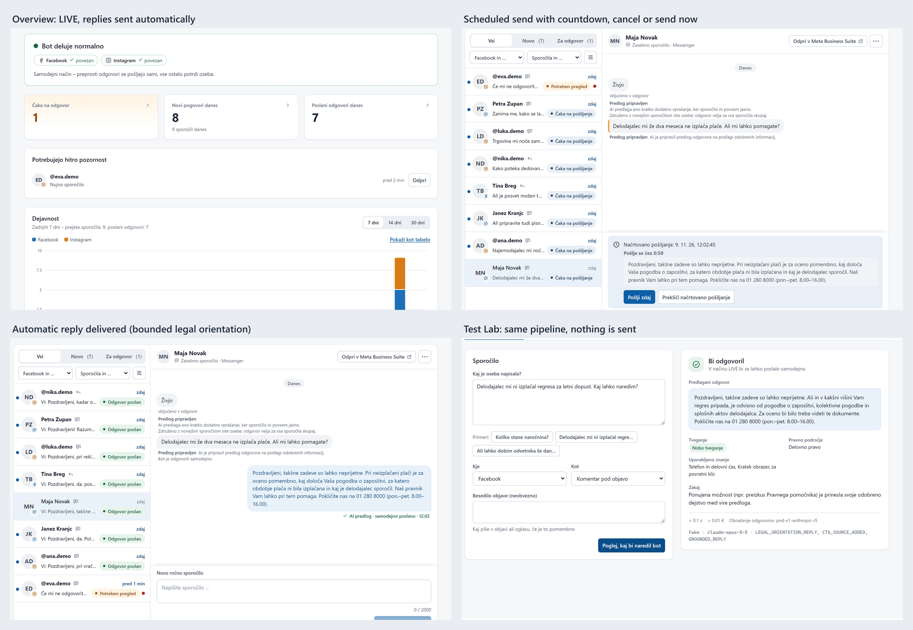
</p>
<p align="center"><sub>The real admin console (Slovenian UI), run locally on synthetic people and messages, with the real pipeline and dispatcher, a scripted model and a fake Meta transport. <a href="#screenshot-provenance">How these were captured</a>.</sub></p>

| | |
|---|---|
| **Status** | In production. Release `pnd-v1-anthropic-r5`, **LIVE with automatic replies** on all four surfaces (owner-reported, November 2026) |
| **Surfaces** | Facebook comments · Messenger · Instagram comments · Instagram Direct |
| **Autonomy** | Ordinary messages answered automatically after a configurable delay (60 s in production); hard-risk messages always go to a person |
| **Tests** | **3,401 automated tests for the messaging bot** at the production commit: 2,808 unit + 593 integration against real PostgreSQL, all passing (re-run 9 Nov 2026). The whole repository, which also holds a separate Content Bot, runs 4,871 ([evidence](docs/testing-and-evaluation.md)) |
| **Real-model dry run** | 92 of 93 legitimate messages auto-sent (98.9 %), 0 of 11 human-only control cases sent. This is an **automatic-handling rate**, not an accuracy figure ([details](docs/testing-and-evaluation.md#real-model-measurements)) |

> **What this repository is.** A technical case study of a private production system, a
> runnable [interactive architecture simulation](apps/demo/), and annotated
> [production excerpts](src-showcase/). It is not the full application. Prompts, the knowledge
> base, evaluation data and deployment material stay private. What is synthetic, excerpted and
> private: [WHATS_PUBLIC.md](WHATS_PUBLIC.md).

---

## Not a chatbot wrapper

A naive integration is `message → LLM → send`. Here, the model is one untrusted component inside
a pipeline where **code decides what may be sent, when, and whether it actually arrived**:


Four states that most systems blur are kept apart: a reply **generated**, **scheduled**,
**attempted**, and **confirmed by Meta**. "Sent" means Meta returned an id, or a read-back found
the reply. The full stage list is [below](#the-pipeline-end-to-end).

## From review-first to high autonomy

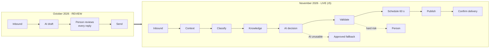

The system started **review-first** on purpose: legal-adjacent conversations, a new Meta
integration and no measured quality. Autonomy was earned in steps (r3 → r4 → r5):
per-surface write verification, a one-click LIVE switch, tiered autonomy (service answers,
bounded legal orientation, human), an approved-fallback level, owner-approved releases bound
to code fingerprints, and recovery for unknown delivery outcomes. Threats, self-harm,
distress, minors, prompt injection, privacy and refund disputes **still go to a person**.

→ [docs/autonomous-live-mode.md](docs/autonomous-live-mode.md)

### The pipeline, end to end

```text
Meta webhook ─► signature over raw bytes ─► durable ingest (1 txn, then 200) ─► normalize 4 surfaces
  ─► context (Graph re-read, thread, post) ─► deterministic risk signals ─► ① understanding (Claude)
  ─► retrieval over release-pinned approved knowledge ─► ② writer (Claude, JSON) ─► validators
  ─► ③ model check ─► autonomy policy ─► schedule (60 s) ─► dispatcher recheck ─► write-ahead
  ─► one Graph POST ─► confirmed id │ outcome_unknown ─► read-back ─► reconcile / bounded resend
```

## The product

The current admin console. Synthetic data, real UI ([provenance](#screenshot-provenance)).

<table>
  <tr>
    <td width="50%" valign="top">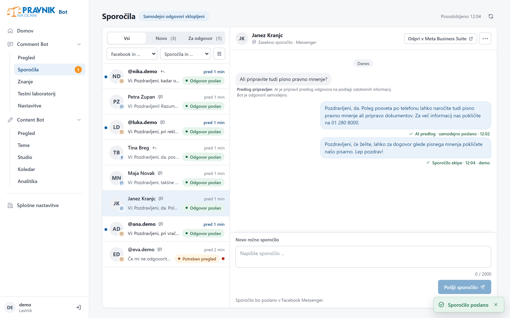<br><b>Automatic reply, then a person.</b> The bot answered a question about written legal opinions from approved knowledge ("AI predlog · samodejno poslano"); a staff member then followed up in the same thread ("Sporočilo ekipe"). Both go through one dispatcher.</td>
    <td width="50%" valign="top">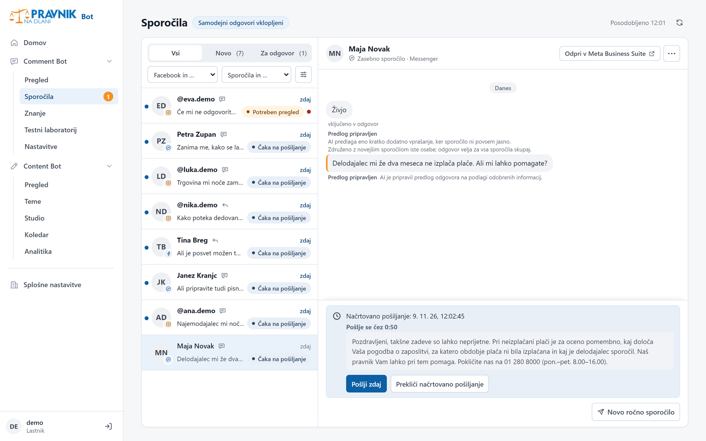<br><b>Scheduled, not yet sent.</b> A bounded-orientation reply to an unpaid-salary question waits out the 60 s delay with a live countdown. Staff can send it now or cancel; every pre-send check still runs.</td>
  </tr>
  <tr>
    <td valign="top">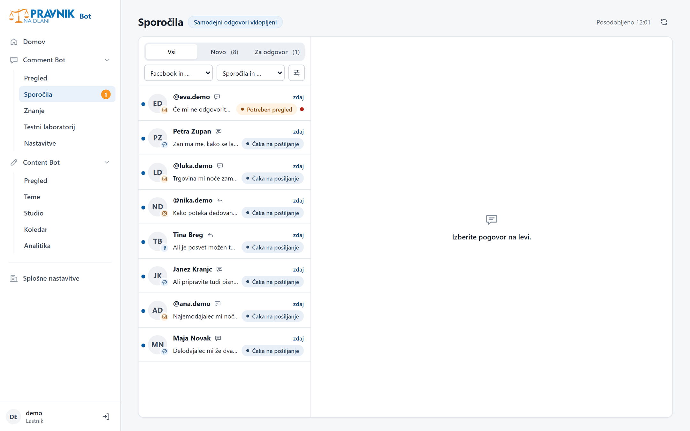<br><b>One inbox, four surfaces.</b> Facebook and Instagram comments and DMs in one list. Here seven replies wait for their send time and one threat is held for a person.</td>
    <td valign="top">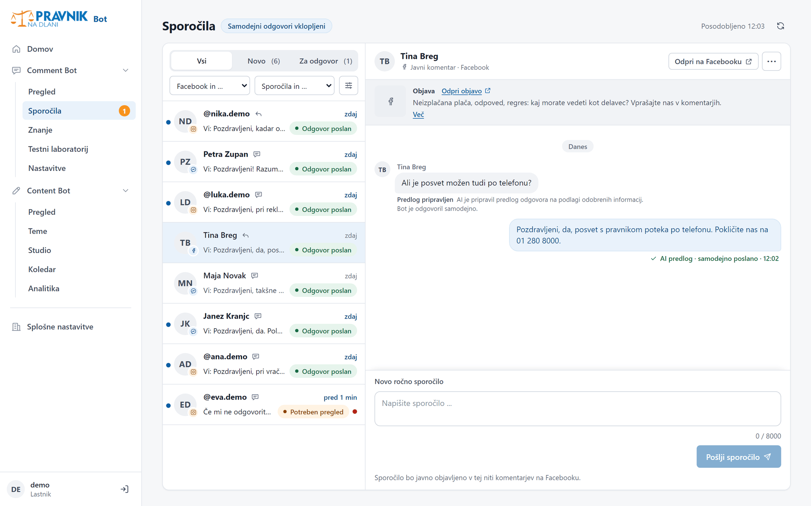<br><b>Comments with post context.</b> A public Facebook comment, the post it belongs to, and the bot's automatic public reply.</td>
  </tr>
  <tr>
    <td valign="top">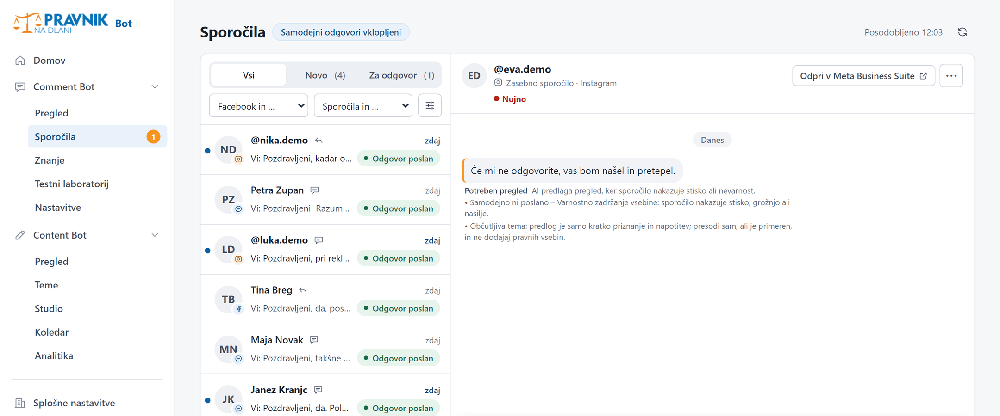<br><b>Hard risk stays human.</b> A threat is never auto-sent. The UI shows why: "Samodejno ni poslano – varnostno zadržanje vsebine".</td>
    <td valign="top">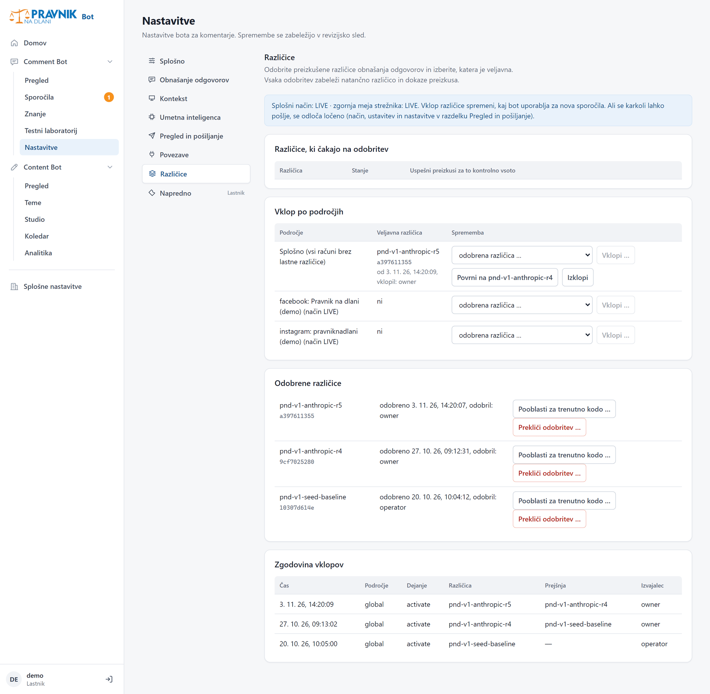<br><b>Releases.</b> r5 active, one-click rollback to r4, the approval and activation history, and "authorize for the current code" after a deploy changes the fingerprints. The baseline release is a synthetic seed.</td>
  </tr>
</table>

<details>
<summary><b>More screens</b>: overview, DM bursts, AI-failure fallback, Test Lab, knowledge, delay settings, Meta readiness</summary>

<table>
  <tr>
    <td width="50%" valign="top">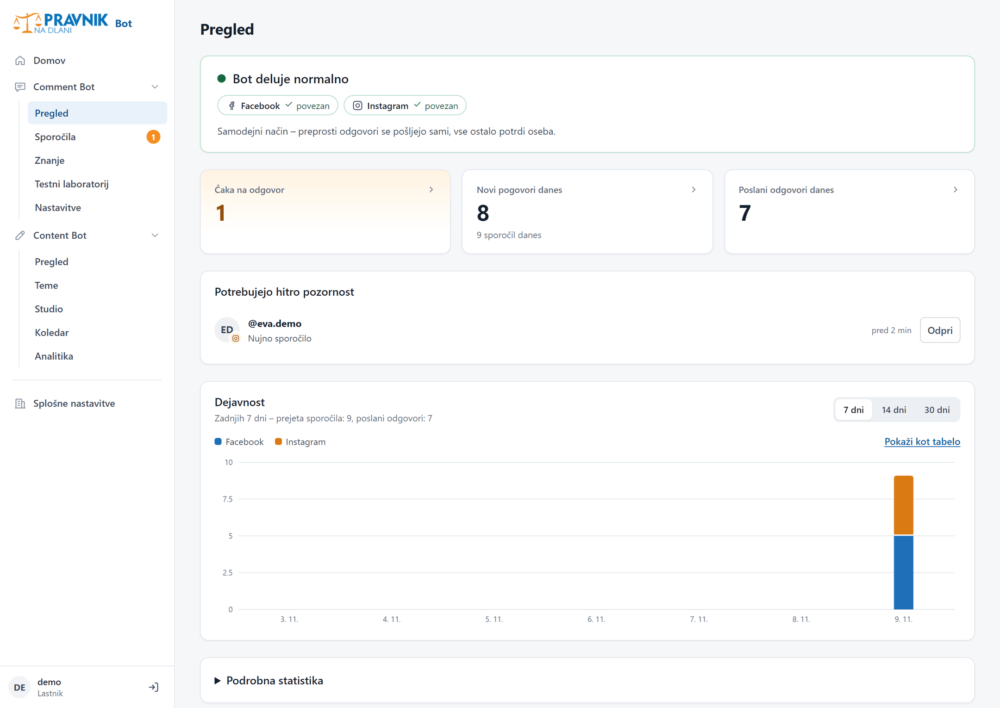<br><b>Overview.</b> Bot status, channel connections, items waiting, replies sent today, urgent items.</td>
    <td width="50%" valign="top">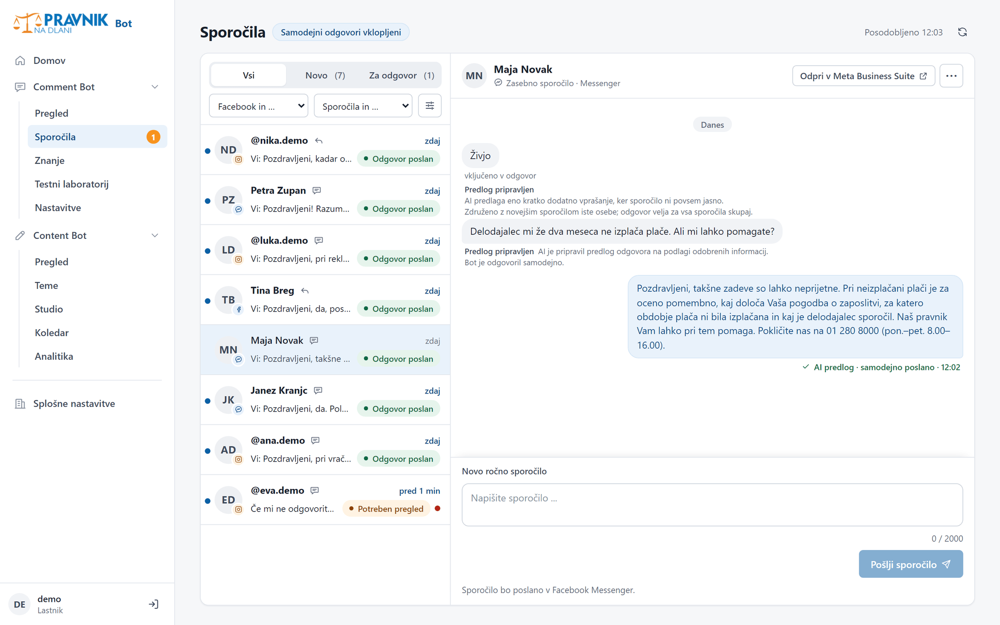<br><b>DM bursts.</b> "Živjo" followed by the real question within the delay window becomes one decision and one reply ("Združeno z novejšim sporočilom").</td>
  </tr>
  <tr>
    <td valign="top">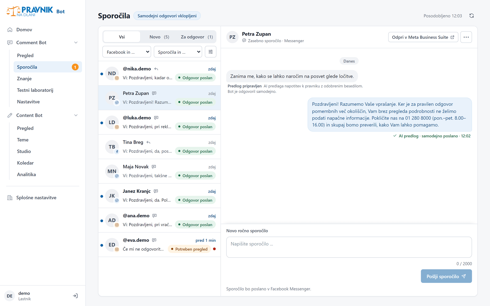<br><b>Model unavailable → approved fallback.</b> An injected model timeout (the one deliberate failure in this set): the release's approved fallback text was sent instead of leaving the person unanswered.</td>
    <td valign="top">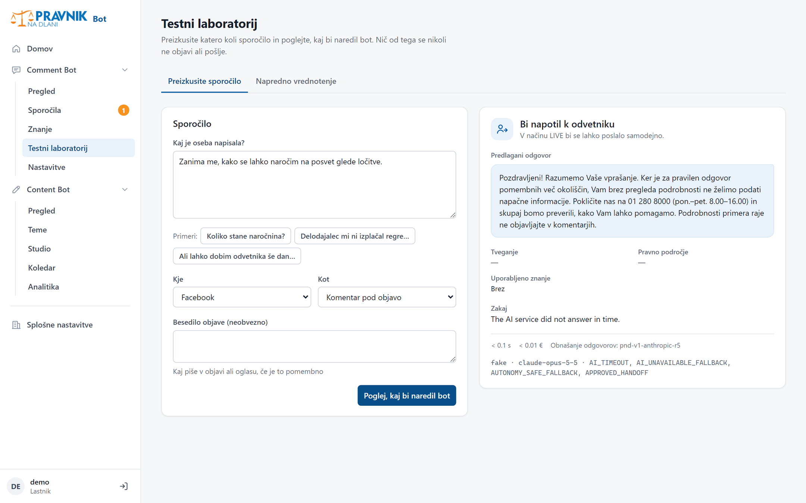<br><b>The same failure in Test Lab.</b> Reason codes <code>AI_TIMEOUT</code> and <code>AI_UNAVAILABLE_FALLBACK</code>; the decision is a referral, not silence.</td>
  </tr>
  <tr>
    <td valign="top">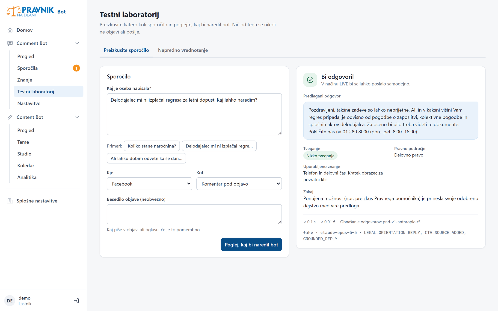<br><b>Test Lab.</b> A holiday-allowance question through the production pipeline, never published: "would reply", employment law, low risk, the knowledge used, reason codes and the active release. Provider shown honestly as <code>fake</code>.</td>
    <td valign="top">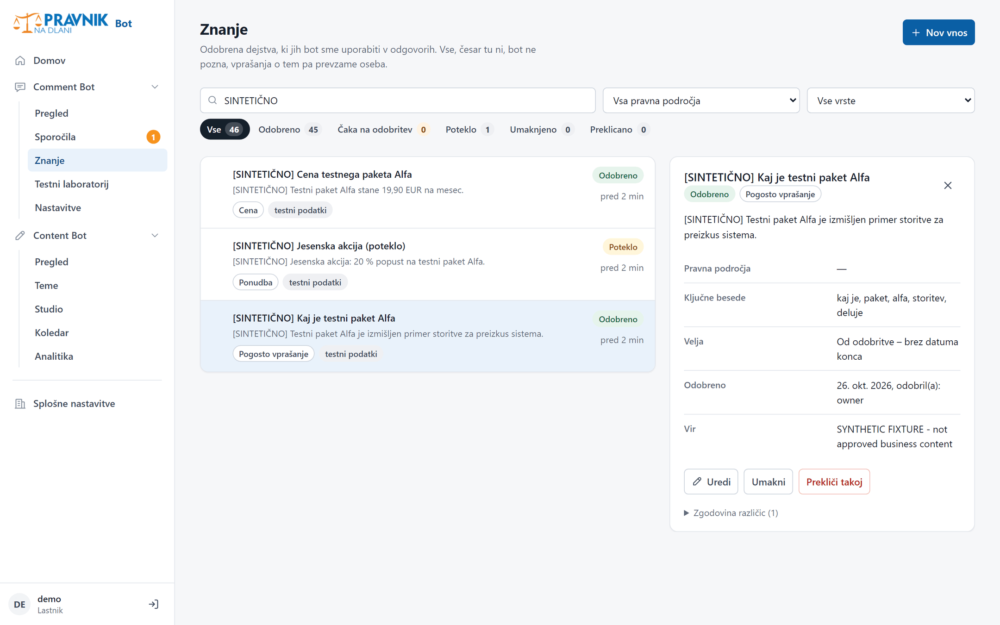<br><b>Versioned knowledge.</b> Typed entries with approval, validity window and source; expired entries are excluded from retrieval automatically. Filtered to synthetic entries.</td>
  </tr>
  <tr>
    <td valign="top">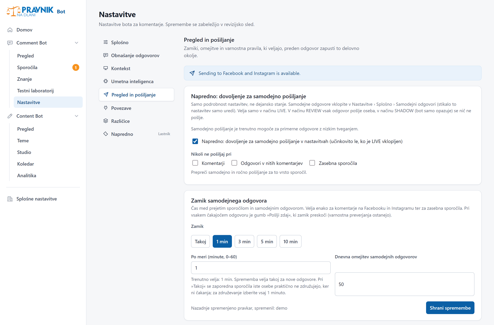<br><b>Configurable delay.</b> 0 to 60 minutes, one setting for all surfaces, plus a daily automatic-send limit.</td>
    <td valign="top">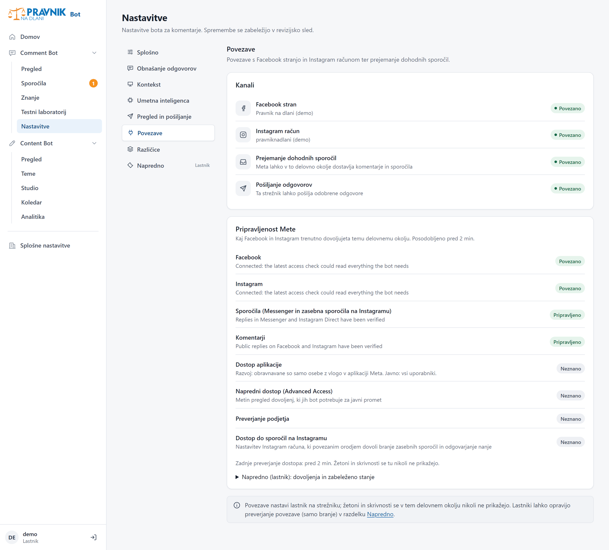<br><b>Meta readiness.</b> Channels, inbound delivery, write verification per surface, and app-access status, tracked separately from bot modes. App-access items read "Neznano" (unknown) in the local environment; production values are owner-recorded.</td>
  </tr>
</table>
</details>

## Interactive demo

[`apps/demo`](apps/demo/) is a browser-only **architecture simulation**: type any message (English
or Slovenian), pick Messenger, Instagram DM or a comment, and watch the 12 pipeline stages run:
signature, normalization, context, intent, legal area, knowledge retrieval, validation or fallback,
an accelerated 60 s countdown, a simulated Meta publish and delivery confirmation. Scenarios include
duplicate webhooks (one reply), transient Meta failures (retry), and an AI outage (approved
fallback). A Developer View shows the normalized event JSON, reason codes, state transitions and
idempotency keys.

<p align="center">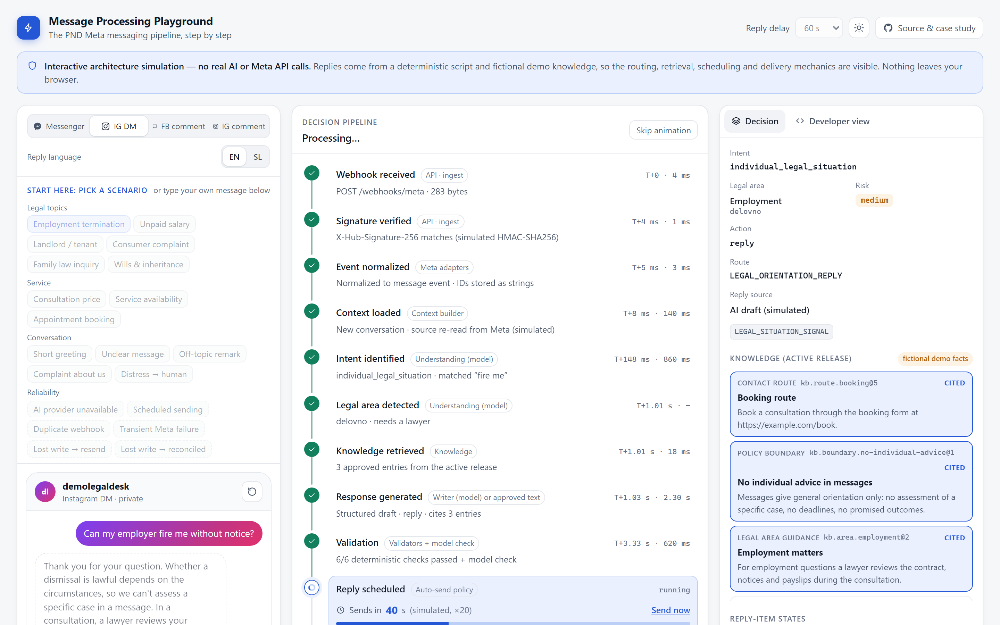</p>

**No real AI, no Meta API, no backend.** Deterministic and free to host.
Run it with `cd apps/demo && npm ci && npm run dev`. Deployment: [apps/demo/README.md](apps/demo/README.md).

## Architecture

<p align="center">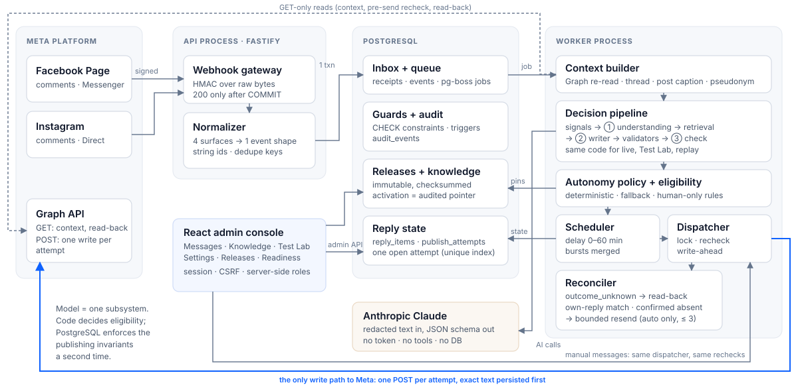</p>

- **One modular TypeScript codebase**, two processes (API, worker), PostgreSQL as both system of
  record and queue (pg-boss). There are no microservices: the hard problems are transactional, not scaling.
- **One decision pipeline** for live traffic, admin preview, Test Lab and historical replay. Only
  the sink differs; replay and SHADOW are structurally unable to publish.
- **The model has no authority.** AI code holds no Meta token, tools or DB handle; a lint rule
  forbids importing a write transport outside `src/publishing`.
- **Invariants live in code and in the database**: CHECK constraints and triggers refuse SHADOW
  sends, sends while paused, edits to frozen attempt text, and a second open attempt per reply.

Diagrams: [system](diagrams/architecture.md) · [message lifecycle](diagrams/message-flow.md) ·
[AI & knowledge](diagrams/knowledge-flow.md) · [publishing & recovery](diagrams/publishing-delivery.md) ·
[releases](diagrams/release-lifecycle.md) · [state machine](diagrams/state-machine.md)

## Engineering challenges I solved

| Problem | Decision | Result |
|---|---|---|
| Four Meta surfaces with different payloads, ids and echo rules | Separate FB/IG adapters, zod-validated normalization to one event shape, string ids, quarantine for unknown shapes | `webhook-payload.ts`, with tests on real webhook shapes |
| Webhooks retried, duplicated, out of order | HMAC over raw bytes; receipt + events + job in **one transaction** before `200`; event dedupe keys; unique reply intents | Duplicate deliveries never produce a second reply |
| A timeout after a write may mean it succeeded | Exact text and attempt persisted **before** the POST; unknown → read-back; resend only when Meta verifiably lacks it (auto replies, max 3) | No blind resends; "sent" only on a confirmed id |
| Meta lists your own reply back differently (NFD, zero-width chars, `{post}_{comment}` ids) | `own-reply-match.ts`: NFC, invisible-char stripping, both id forms, time window | Fixed a real "nothing was sent" false failure on all four surfaces |
| Auto replies and staff replies racing | Dispatcher three-phase lock with `row_version`; queued manual message cancels a pending auto reply (`SUPERSEDED_BY_MANUAL_MESSAGE`) | A person and the bot never answer the same message twice |
| Three DMs in ten seconds | Burst coalescing inside the delay window; review is per item, never a conversation lock | One reply per burst |
| New code, stale authorization | LIVE authorization bound to release checksum **and** behavior/dispatch code fingerprints | Every deploy that changes behavior stops auto-send until a free, audited owner re-authorization |
| A model that over-reads risk ("nasilje" in a workplace-harassment question) | Deterministic corroboration (`HARM_TOPIC_LEGAL_REQUEST`, `MODEL_URGENCY_NOT_IN_TEXT`); acute-danger words still block | Real legal questions answered; real threats still held |
| Provider timeouts leave people unanswered | `AI_UNAVAILABLE_FALLBACK`: approved generic text unless a hard signal forbids it | Outages degrade to an honest contact route, not silence |
| Formal Slovenian address ("vikanje") | Release style pin + `INFORMAL_ADDRESS` final check + normalization; approval refuses informal approved texts | Every automatic reply in r5 is formal |

→ The full write-up, with code references and trade-offs: [docs/engineering-challenges.md](docs/engineering-challenges.md)

## Knowledge and AI orchestration

The model is **not fine-tuned**. Domain reliability comes from orchestration:

- **Three constrained calls** (understanding, writer, independent checker), each with a JSON
  schema and runtime validation. Invalid output is a typed failure with a fallback, never a
  partial answer.
- **Classification first**: 14 intents and 17 legal-area labels plus risk flags drive routing
  and retrieval. Deterministic signals run before and after the model and can overrule it.
- **Release-pinned knowledge**: typed entries (FAQ, service fact, price, offer, contact route,
  link, boundary, legal-area guidance) with scope, validity window, approval and immutable
  versions. Only entries pinned by the active release can be retrieved.
- **Grounding is checked, not trusted**: every price, URL, phone and offer term in a draft must
  exist in a cited approved entry; unsolicited prices are removed; legal verdicts, invented
  call-backs and unneeded emergency numbers are refused.
- **A response hierarchy**: full answer → bounded orientation → partial answer and
  clarification → honest contact route → approved fallback → person.
- **Portable by configuration**: a new organization means new knowledge, a new release
  manifest (policy, style, approved texts, auto-send intents) and the same engine.

→ [docs/knowledge-system.md](docs/knowledge-system.md) · [docs/adapting.md](docs/adapting.md)

## Testing and evidence

| Evidence | Value | What it is | What it is not |
|---|---|---|---|
| Automated tests at `8e22656`, messaging bot | **2,808 unit (116 files) + 593 integration (49 files) = 3,401**, re-run 9 Nov 2026, 0 failed. Whole repository incl. the separate Content Bot: 3,985 + 886 = 4,871 | Deterministic, scripted model outputs, fake Meta transport, **real PostgreSQL** | Model-quality evidence |
| r4 paid evaluation `269a650d` (29 Oct) | 107/107 cases completed; action accuracy **98.1 %** (pass); auto-reply appropriateness 90.5 % (**fail**, gate ≥ 98 %) | Fresh real-model run on a labelled synthetic + historical dataset | A gate pass: one mandatory gate failed; the diagnosis led to fix `56c26d5` |
| Real-model dry run (28 Oct) | 92/93 legitimate messages auto-sent (98.9 %), 0/11 human-control cases sent, 0 unsolicited amounts | Real Anthropic models through the real pipeline, eligibility and dispatcher recheck; nothing published | Accuracy; production traffic |
| r5 paid evaluation (3 Nov) | 134/134 completed, gates **failed** | Fresh real-model run | Why r5 went LIVE (see below) |
| r5 LIVE (3 Nov →) | Owner-approved release (`owner-approved-v1`), real Meta delivery observed by the owner | Production | Measured quality: the approval record states `evaluatedCases: 0` |

The paid evaluation became optional by an explicit owner decision (ADR 0005). The system says
so: an owner approval is recorded as an owner approval, not as measured quality. Safety rests on
the runtime invariants, which never read the evaluation. → [docs/testing-and-evaluation.md](docs/testing-and-evaluation.md)

## Production incidents and what they changed

Three real findings from operating the system. Each one is a problem, a root cause and a code change.

| Finding | Root cause | Change |
|---|---|---|
| The admin console said "nothing was sent" for a reply that **had** been posted (Facebook "edit and send", seen in operation) | Meta listed our own reply back with different text normalization (NFD, zero-width and non-breaking characters) or a `{post}_{comment}` id. Reconciliation of the unknown outcome gave up, and the next send classified our own reply as someone else's (`ANSWERED_ELSEWHERE`) | `own-reply-match.ts`: NFC, invisible-character stripping, both id forms, attempt-time window. Fixed on all four surfaces; the item ends `sent` / `reconciled_sent` without a second write |
| A real Instagram DM asking for help with a workplace-harassment legal problem ("nasilje") was held as a threat (3 Nov, under r5 LIVE) | The deterministic violence signal and the model's threat reading each made it human-only, the approved fallback was blocked by the same flag, and the LIVE signal would have refused an automatic send anyway | `HARM_TOPIC_LEGAL_REQUEST` (ADR 0006): harm vocabulary inside a legal-help request is a legal topic, but only with none of acute danger, threat, self-harm, distress or a minor. It then goes through the ordinary tiers and validators; real threats still go to a person |
| The paid r4 evaluation failed a gate (auto-reply appropriateness 90.5 %, need 98 %), including two reported critical violations | The two critical hits were **scorer** false positives (a correctly declined statement such as "I cannot confirm that this is the right number" matched a forbidden-claim pattern). The other failures were **pipeline** bugs: the unsolicited-price stripper removed prices people had asked for ("70 evrov", a price asked in the previous turn, package comparisons) | `56c26d5`: non-assertive-statement rules in the scorer, with negative controls that stay critical; a corrected price-question detector. A cache-only replay of the real-model dry run changed 1 of 143 cases |

→ [docs/evolution.md](docs/evolution.md) · [docs/testing-and-evaluation.md](docs/testing-and-evaluation.md)

## Why LIVE without a passing evaluation

The r5 paid run completed 134 of 134 cases and **failed the gates**. The owner then decided that the
paid evaluation is optional (ADR 0005), and r5 went LIVE as an **owner-approved** release
(`basis: owner_approval`, `evaluatedCases: 0`). That is a business decision, recorded as one. It is
not evidence of reply quality, and nothing in this repository presents it as such.

What carries the safety instead is runtime code that never reads an evaluation result:

- **Hard-signal holds.** Threats, self-harm, distress, minors, prompt injection, privacy requests,
  refund disputes and critical risk go to a person, at decision time and again at dispatch.
- **Grounding and knowledge eligibility.** Every price, link, phone number and offer term must exist
  in a cited approved, in-scope, unexpired entry; unsolicited prices are removed; legal verdicts are refused.
- **Approved fallback.** When the model output is unusable or the model fails, the release's approved
  generic text is sent, unless a hard signal forbids even that.
- **Dispatcher pre-send recheck.** Pause, mode, scope, release, source still existing, human takeover,
  prior replies, messaging window and knowledge validity are checked again immediately before the write.
- **Least-permissive mode and pause.** The effective mode is the minimum of ceiling, global and account
  mode; a pause stops new sends at once (it cannot recall a request already sent, and the UI says so).
- **Authorization bound to the code.** The LIVE authorization is tied to the release checksum and to
  the behavior and dispatch code fingerprints, so a deploy that changes either stops automatic
  sending until the owner re-authorizes (free, audited).
- **A delay window with manual takeover.** Replies wait 60 s; staff can send now, cancel or write
  their own message, which cancels the pending automatic reply.

**Monitoring.** `release-status` reports automatic coverage as *handled* versus *delivered*; unknown
delivery outcomes are reconciled and tracked; permanent rejections, exhausted retries and unresolved
outcomes log a structured `DELIVERY_NEEDS_OPERATOR` alert.

**Rollback.** Activate the previous approved release (one click; approval refuses a release with no
rollback target), pause, or lower the mode (always allowed, audited). **Not provided:** measured
quality for r5. Its quality rests on the owner's judgment, the deterministic validators and the
invariants above. → [docs/autonomous-live-mode.md](docs/autonomous-live-mode.md)

## Quick start

```bash
git clone https://github.com/gabercmatej/Meta-message-answering-bot.git
cd Meta-message-answering-bot

# 1. Interactive demo (no keys, no backend)
cd apps/demo && npm ci && npm run dev          # http://localhost:5173 (no hosted instance yet)
npm test && npm run build                      # 74 simulator tests, static build
```

Node.js 20+. No database, network access or credentials. What the public build
does **not** include, and what a real integration would need: [docs/adapting.md](docs/adapting.md).

## Repository map

| Path | Contents |
|---|---|
| [`apps/demo`](apps/demo/) | Interactive architecture simulation (React + Vite, static, Vercel-ready) |
| [`docs/`](docs/) | Architecture, autonomy, challenges, knowledge, Meta, testing, deployment, privacy, evolution |
| [`diagrams/`](diagrams/) | Mermaid sources for every diagram |
| [`screenshots/`](screenshots/) | Current UI (November 2026); [`archive-2026-10-01/`](screenshots/archive-2026-10-01/) holds the REVIEW-era set |
| [`examples/`](examples/) · [`src-showcase/`](src-showcase/) | Sanitized decision/webhook/knowledge records; annotated excerpts from the October showcase |
| [`scripts/privacy-scan.mjs`](scripts/privacy-scan.mjs) | Dependency-free secret/PII/identifier scanner for the tree and Git history |
| [`WHATS_PUBLIC.md`](WHATS_PUBLIC.md) | What is synthetic, what is excerpted from production, what stays private, screenshot provenance, licence |

## Project evolution

| Date (2026) | Milestone |
|---|---|
| 28–30 Sep | Four-surface normalization from real Meta webhook shapes; GET-only Graph transport; Test Lab; release-pinned AI routing with Anthropic; first real-model evaluation and fixes; REVIEW lifecycle; controlled write verification |
| 1 Oct | Production in **REVIEW**; Messenger and Instagram DM write-verified; first public showcase |
| 8–20 Oct | Slovenian operator UI; conversation inbox (v2.0); continuous messaging after a confirmed reply; conversation engine and knowledge v2 |
| 21–26 Oct | r3: owner-approved knowledge, evaluation policy `review-evidence-v1`, one-click LIVE switch, fail-closed LIVE eligibility |
| 26–28 Oct | r4 **autonomy-v1**: tiered autonomy, bounded legal orientation, DM bursts, own-reply matching fix, configurable delay, approved fallback level |
| 28–29 Oct | All four Meta endpoints write-verified (owner-reported); manual messages after automatic replies; paid r4 run 269a650d fails one gate → scorer and price-stripper fixes |
| 3 Nov | r5: mandatory formal address, narrowed risk signals; `owner-approved-v1` releases; **full autonomy** (AI-failure fallback, resend after confirmed absence, operator alerts); r5 LIVE at 60 s |
| 9 Nov | Showcase v2: current screenshots, interactive demo; engine extract prepared, held pending authorization |

→ [docs/evolution.md](docs/evolution.md)

## Security and privacy

- Screenshots, demo content and examples are **synthetic**. The automated privacy scan covers the
  working tree and the public Git history ([`scripts/privacy-scan.mjs`](scripts/privacy-scan.mjs)), and
  every screenshot was reviewed by eye.
- In production: text is redacted before it reaches the AI provider, the model sees a
  pseudonymous author, tokens never reach the browser, logs are structured and redacted,
  reviewer-only identity data is pruned on a schedule.
- Report a vulnerability: [SECURITY.md](SECURITY.md). Details: [docs/privacy-and-security.md](docs/privacy-and-security.md).

## Screenshot provenance

All product screenshots in [`screenshots/`](screenshots/) were captured on 9 November 2026 from
the production admin build at commit `8e22656`, run locally against a throwaway embedded
PostgreSQL. The pipeline, autonomy policy, validators, scheduler and dispatcher are the real
code. The Meta adapter and publish transport are fakes (nothing left the machine), the model is a
scripted stand-in (no paid calls), and every person, message and post is invented. Status panels
use a production-shaped configuration with dummy credentials, so they read "graph" while sending
goes to the fake. The knowledge view is filtered to synthetic entries. Exactly one case (07 and 10) is a
deliberately injected model timeout, to show the fallback path. A few status strings in the
Slovenian UI are still English in this build, and two settings texts predate LIVE mode; they are
shown as captured, not edited. Captures are 1.5× scale; the hero is a 2×2 composition of the same
captures with English pane titles added. The October REVIEW-era set in
[`screenshots/archive-2026-10-01/`](screenshots/archive-2026-10-01/) was captured the same way from
invented data. See also [WHATS_PUBLIC.md](WHATS_PUBLIC.md).

## About

Designed, implemented and operated by **Matej Gaberc** ([@gabercmatej](https://github.com/gabercmatej))
for Pravnik na dlani: Meta integration, the decision pipeline and autonomy policy, knowledge and
release management, the React operator console, the publisher and reconciliation, evaluation
tooling, deployment and production operations. All commits in the private repository come from
the author's account. Much of the implementation was written with AI coding agents (Claude Code)
working under the author's direction and review, as the project log records; the architecture,
invariants, verification and production operation are the author's. Product and policy decisions,
such as autonomy scope and the optional paid evaluation, were made by the business owner and are
recorded as such.

---

<sub>© 2026 Matej Gaberc. Portfolio case study. No licence is granted for the documentation or for
the production code extract; see [NOTICE.md](NOTICE.md) and [WHATS_PUBLIC.md](WHATS_PUBLIC.md).
"Pravnik na dlani" is named for context only; this repository is not an official channel of the
company and nothing here is legal advice.</sub>
