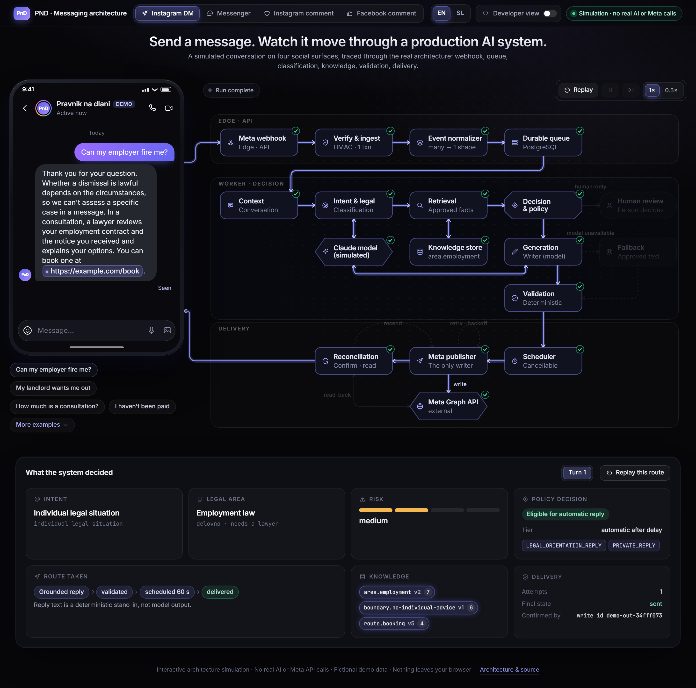

# PND · Messaging architecture (interactive demo)

A browser-only, dark-mode exhibit: send a message on a simulated Instagram DM, Messenger, Instagram
comment or Facebook comment and watch a packet travel through the real architecture of the PND
messaging system (webhook, verification, queue, classification, knowledge, decision gate, validation,
scheduler, publisher, reconciliation) and back to the device.

> **Interactive architecture simulation · No real AI or Meta API calls.** Replies come from a
> deterministic script and fictional knowledge records. The model node is labelled "Claude model
> (simulated)"; results say "deterministic stand-in". Every grounded fact in a reply (price, hours,
> booking link) is a chip that says "Fictional demo value · from knowledge record <id> v<version>".
> No real logos, handles, phone numbers or prices; the production build makes no network requests
> (fonts are bundled; `vercel.json` sets `connect-src 'none'`).

<p align="center"></p>

## Modes and examples

- Four surfaces: Instagram-style DM, Messenger-style DM, Instagram-style comment, Facebook-style
  comment (labelled "simulated"). The reply appears only after the packet has completed its route.
- Four suggestion chips under the composer (one click = fills the composer and sends) plus
  "More examples": everyday questions and failure modes (AI unavailable, duplicate webhook,
  transient Meta failure, uncertain write found / absent, human-only message, scheduled sending).
- EN / SL toggle, Developer view (timeline, event, classification, knowledge, attempts), turn
  selector with route replay, playback controls (replay, pause, 1x / 0.5x, skip).

## Routes (derived from the trace)

`src/route.ts` `buildRoute(trace)` is a pure function from the simulator's `RunTrace` (stages, fault,
action, attempts) to a list of steps (edge, direction, node, outcome, dwell, payload label). The
renderer plays exactly that list, so each run takes a different path:

| Run | Route |
|---|---|
| Normal | webhook, verify, normalize, queue, context, intent <-> model, retrieval <-> knowledge store, decision, generation <-> model, validation, scheduler (60 s shown accelerated), publisher -> Graph API -> reconciliation -> device |
| Human-only / distress | stops at the amber Human review terminal; nothing is sent |
| Off-topic public remark | stops at the decision gate |
| AI unavailable | model fails, dashed bypass to the approved fallback, then validation |
| Duplicate webhook | a second packet enters, dies at the normalizer ("dedupe key seen") while the first continues |
| Transient Meta failure | Graph 429, backoff, retry arc, success |
| Uncertain write, found | read-back from Graph finds the reply, `reconciled_sent` |
| Uncertain write, absent | read-back finds nothing, resend arc, success |

## Run and test

```bash
cd apps/demo
npm ci
npm run dev            # http://localhost:5173
npm run typecheck
npm test               # simulator, playback state, buildRoute / timeline / chips
npm run build
npm run check:browser  # headless Chromium over dist/; also rewrites assets/demo/*.png
```

`check:browser` asserts the initial screen has no results, all four modes, EN/SL, no early reply,
specific node states per route, the developer view, no external requests, no console errors and no
horizontal overflow at 375/390/768/1440 px.

## Structure

```text
src/sim/            deterministic simulator (unchanged engine) + tests
src/route.ts        buildRoute, timeline, pure graph view (viewAt) + route.test.ts
src/graph/          model (ids), topology (wide + tall layouts, router), ArchGraph (SVG)
src/usePlayback.ts  one rAF clock; run-scoped via playbackState.ts
src/components/     TopBar, device mocks, Suggestions, Results, DevView
```
