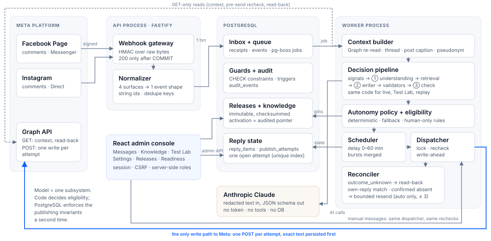
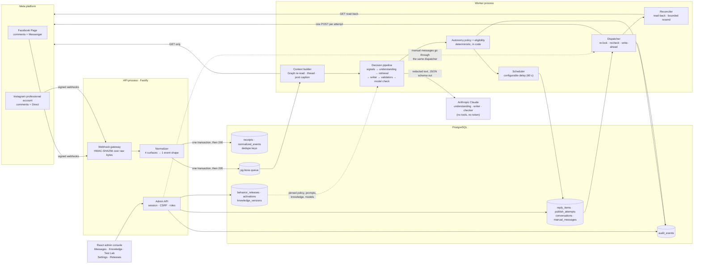

# A. System architecture

One TypeScript repository, two processes (API and worker), one PostgreSQL database that is the
system of record **and** the job queue. The model is one subsystem among many; only the publishing
module can write to Meta.

Same diagram as editable Mermaid (wide)

## Boundaries that are enforced, not just drawn

| Boundary | Enforcement |
|---|---|
| AI code cannot publish | AI modules receive no Meta token, no tools and no DB handle; an ESLint import rule forbids publishing imports from AI code |
| Only the dispatcher writes to Meta | The Graph writer is constructed only by the publisher; read adapters are GET-only |
| SHADOW and replay can never send | Mode check in code **and** PostgreSQL CHECK constraints / triggers on `reply_items` and `publish_attempts` |
| One open attempt per reply | Partial unique index `publish_attempts_one_open` on `(reply_item_id) WHERE state IN ('pending','outcome_unknown')` |
| A release is immutable | Checksummed manifest; activation is an audited pointer; edits create a new version |
| Preview = production | Live events, Test Lab, admin preview and historical replay run the same `decide()`; only the sink differs |

See [docs/architecture.md](../docs/architecture.md) for the module map and trade-offs.
