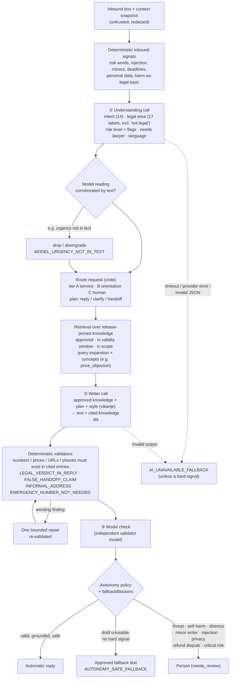

# C. AI reasoning and knowledge retrieval

Three model calls, each with a JSON schema, surrounded by deterministic code. The model never
chooses what is allowed to be sent; it proposes, and code verifies against approved knowledge.

What is **not** happening: no fine-tuning, no custom-trained model, no hidden chain-of-thought
stored. The system records concise reason codes and knowledge ids for every decision.
