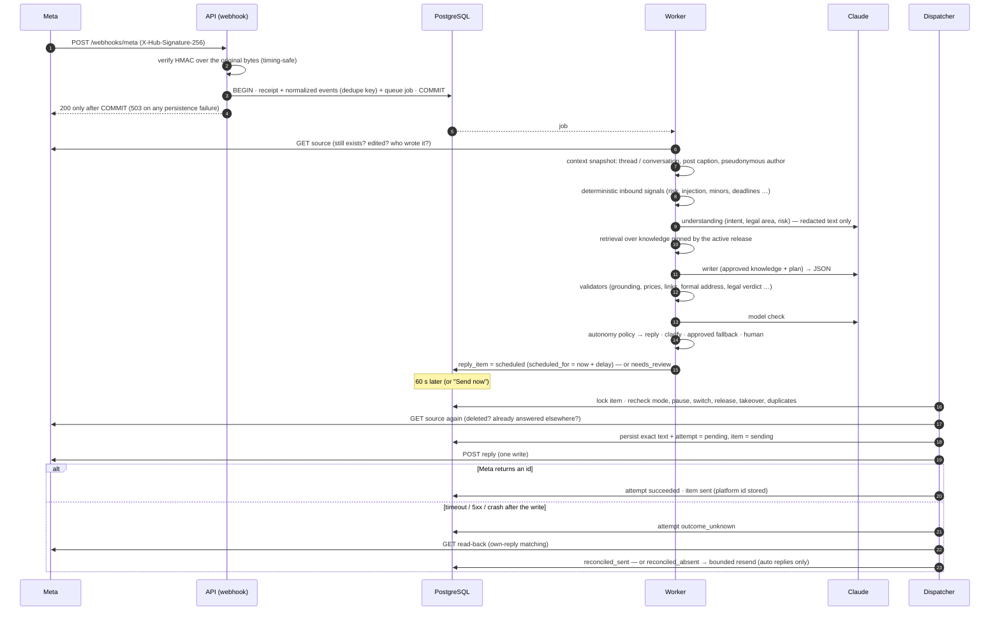

# B. Incoming message lifecycle

From the webhook bytes to a reply confirmed by Meta. Every arrow that crosses a process or a
network boundary is durable on one side before it happens.

Key property: **"sent" is a confirmed Meta write, never an assumption.** A reply that was
generated, scheduled or attempted is not reported as sent.
