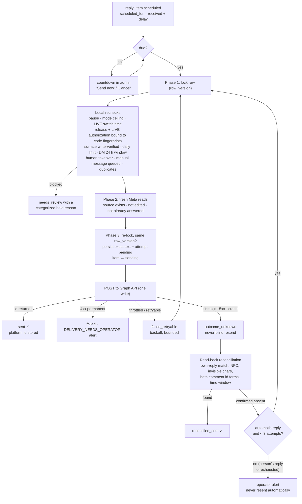

# D. Automatic publishing, scheduling and delivery recovery

The same dispatcher sends **manual** staff messages composed in the admin; a pending automatic
reply to the same person is cancelled (`SUPERSEDED_BY_MANUAL_MESSAGE`) when staff write first.
