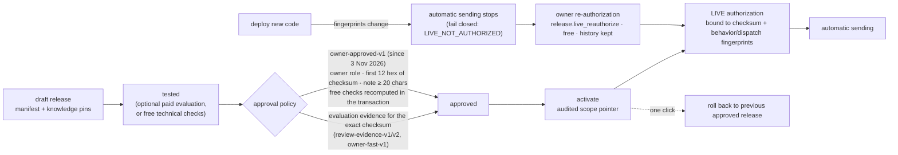

# E. Release management and deployment lifecycle

A **behavior release** is an immutable, checksummed manifest that pins the policy, prompt
version, examples, knowledge versions, retrieval settings, models and auto-send policy. What the
bot may do automatically is bound to both the release checksum **and** the fingerprint of the
running code.

Evaluation-evidence policies (October): `review-evidence-v1` and `v2` require a completed fresh-model run on the
exact release checksum with the gates passing; `owner-fast-v1` (26 Oct) is `v2` with the per-case human-rating
requirement removed and the safety checks recomputed from one run. None of them is needed for owner approval.

Owner approval is recorded as `basis: owner_approval`, `evaluatedCases: 0`, `livePrecision: null`:
it is explicitly **not** evidence of measured quality, and the UI and CLI never present it as such.
