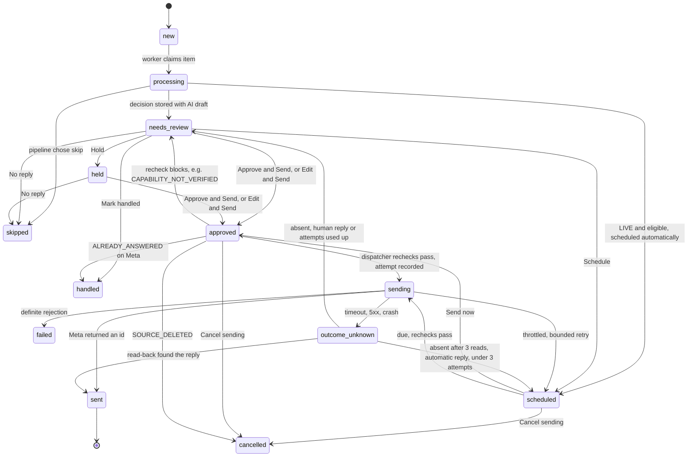

# Review flow

> **Updated 9 November 2026.** Item states and human actions, as in LIVE (release r5). In LIVE,
> eligible items enter `scheduled` automatically instead of waiting in `needs_review`, and an
> unknown delivery outcome of an *automatic* reply can return to `scheduled` for a bounded resend
> (diagram and invariants below). The October REVIEW phase used the same states without the
> automatic paths. See [autonomous-live-mode.md](../docs/autonomous-live-mode.md) and
> [state-machine.md](state-machine.md).

Reply item states and the human actions that move them. Details:
[../docs/safety-and-review.md](../docs/safety-and-review.md#human-review).

Invariants on this state machine:

- The AI draft is immutable; the human's final text is stored separately.
- Entering `approved`, `scheduled` or `sending` is refused by a database trigger while paused or
  below REVIEW, and is impossible for items created in SHADOW.
- `sent` is final.
- At most one open attempt (`pending` or `outcome_unknown`) per item. `outcome_unknown` is never
  resent blindly: it is first reconciled by reading Meta back. Only an **automatic** reply that
  Meta verifiably lacks after the reconciliation reads (`reconciled_absent`) is resent, after a
  fresh read and a full pre-send recheck, at most 3 attempts in total. A human reply is never
  resent automatically.
- A `DELIVERY_NEEDS_OPERATOR` alert is logged for an unresolved outcome, a permanent rejection or
  exhausted throttling retries.
- Every transition is written to the audit log.
