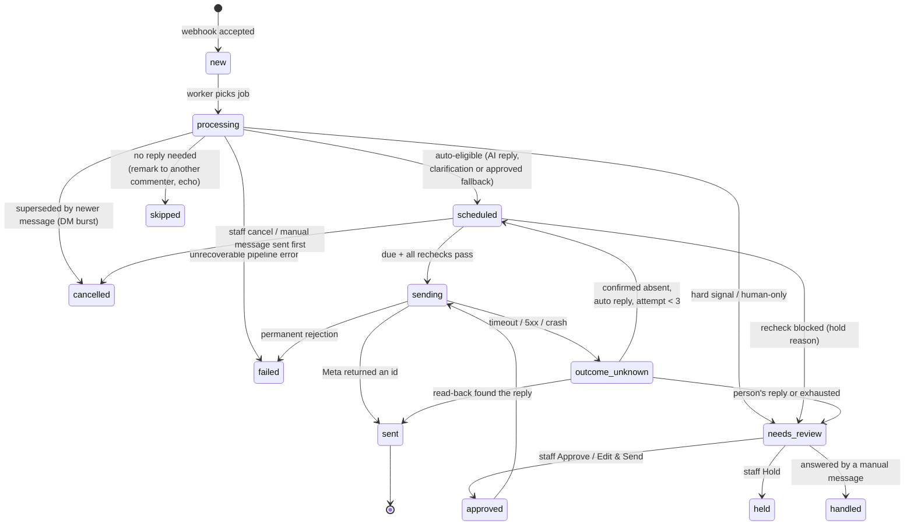

# F. Reply state machine (including errors and fallback)

`reply_items.state` and `publish_attempts.state` as defined in the production migrations.

Attempt states: `pending → succeeded | failed_retryable | failed_permanent | outcome_unknown → reconciled_sent | reconciled_absent`.
At most one attempt per item can be open (`pending` or `outcome_unknown`).
