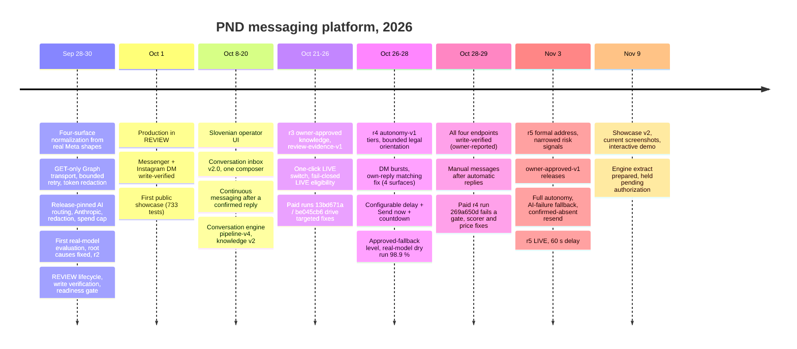

# Project evolution

Dates come from the private repository's commit history and its project log. The private
repository's Git history starts on **28 September 2026**. Earlier phases (0 to 5: local stack,
ingestion, knowledge, evaluation, Test Lab) were built and verified before that and are recorded in
the project log, so they do not appear as separate commits.

## Milestones in detail

| Date | Commit(s) | What happened | Why it mattered |
|---|---|---|---|
| 28 Sep | `9181960` | All four inbound surfaces normalized from real Meta webhook shapes | One pipeline instead of four |
| 28 Sep | `8f2d173` | GET-only Graph transport with bounded retry and token redaction | Reads can never write; tokens never logged |
| 29 Sep | `00bd8be` | PND knowledge, a draft release, the legal case corpus and the stage-by-stage Test Lab | Behavior became data, testable without traffic |
| 30 Sep | `fd97f4b`, `51ff742` | AI routing by release pin, Anthropic models, redaction, spend cap; fixes after the first real evaluation | No silent model substitution; measured failures fixed |
| 30 Sep | `9f1093b`, `406c5e7` | Reply lifecycle and review actions; controlled write verification per surface; REVIEW readiness gate | Nothing sends on an unproven surface |
| 1 Oct | `80cdc96` | Production REVIEW; Messenger and Instagram DM verified; first showcase | Real users, a human on every reply |
| 8 Oct | `0dd0ee9`, `8ed5cf3` | Slovenian operator UI; server-side refusal to resend unchanged blocked text | The operators are Slovenian staff |
| 20 Oct | `0acd9d2`, `0d9f580`, `b44436c` | v2.0 conversations, unified pre-send blocks, one composer; manual follow-ups after confirmed replies | The inbox became a conversation tool |
| 21–23 Oct | `24531e6` … `a246fa7` | r3: owner approvals, evaluation policy, cost guard, LIVE switch, fail-closed eligibility, usability passes | The path to LIVE got explicit gates |
| 26–27 Oct | `ff4b49e`, `bce2574`, `9ccada6`, `4c9bdaf`, `a55ffac` | r4 autonomy-v1 and four optimization passes; configurable delay | Coverage from 30.5 % to 68.6 % of evaluated cases (engineering estimate) |
| 28 Oct | `f4a5d75`, `db19e23`, `3c056ff`, `0307b9d` | Approved fallback level; comment auto-send test 32/32; manual replies after automatic ones; stale-status fix | No dead ends for people or staff |
| 29 Oct | `56c26d5` | Scorer false positives and price-stripper bugs fixed after the failed paid run | Evaluation honesty: the scorer was wrong twice, and the code was wrong four times |
| 3 Nov | `3d0efc0` | r5: mandatory vikanje, complaint texts, narrowed signals, dataset v5 (134 cases) | Tone consistency, fewer false holds |
| 3 Nov | `66470f0` | `owner-approved-v1` approval and `live-owner-approved-v1` authorization | The business decides; the record says it is not measured quality |
| 3 Nov | `8e22656` | Full autonomy: harm-as-legal-topic, AI-failure fallback, resend after confirmed absence, operator alerts | Real production failure fixed (a legal question held as a threat) |

## Test-suite growth

| Date | Messaging bot (unit + integration) | Whole repository (unit + integration) |
|---|---|---|
| 1 Oct (`80cdc96`) | 511 + 222 = **733** | same (the Content Bot did not exist yet) |
| 26 Oct (`ff4b49e`) | not measured separately | 3,450 + 844 = 4,294 |
| 28 Oct (`f4a5d75`) | not measured separately | 3,764 + 848 = 4,612 |
| 29 Oct (`56c26d5`) | not measured separately | 3,872 + 875 = 4,747 |
| 3 Nov (`8e22656`), re-run 9 Nov | 2,808 + 593 = **3,401** | 3,985 + 886 = 4,871 |

From 5 October the repository also contains a separate Content Bot module, so the middle rows are
whole-repository counts and the two columns must not be mixed. The messaging-bot figure for the
showcase is **3,401** tests ([details](testing-and-evaluation.md#re-run-for-this-showcase)).
